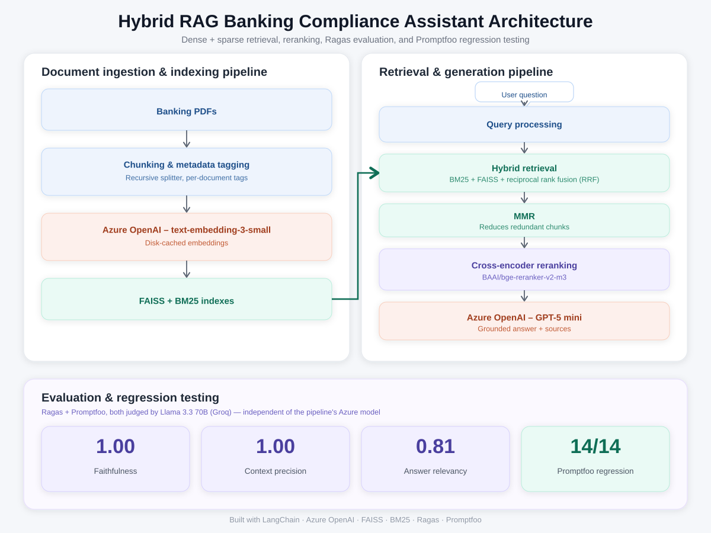

# Hybrid RAG: Banking/AML Compliance Assistant

A production-structured retrieval-augmented generation (RAG) system for answering questions over
banking compliance documentation, built with a hybrid retrieval pipeline (dense + sparse search,
reranking, and metadata-aware chunking) on top of Azure OpenAI, and evaluated with two
complementary layers: Ragas quality scoring and Promptfoo regression testing.

This repository is a refactored, modular version of an original prototype notebook (retained under
`notebooks/` for reference), restructured into a standard Python package layout suitable for version
control, testing, and reuse outside of a single notebook.

## Source Documents

The knowledge base is two **fictional, self-authored** policy documents for an invented institution,
**Eastmere Bank**, written specifically for this project:

| Document | Format | Purpose in the corpus |
|---|---|---|
| `Eastmere Bank - KYC and CDD Procedures FAQ.pdf` (EMB-KYC-FAQ-001) | 29 numbered Q&As | Due diligence procedures, thresholds, review cycles |
| `Eastmere Bank - AML Risk Assessment Policy.pdf` (EMB-AML-RAP-002) | Narrative policy, `RA-x.x` sections | Risk scoring model, tier thresholds, country risk, governance |

The documents are designed as a **test corpus**, not just content:

- **Cross-references:** the FAQ points to the policy for how risk tiers are calculated, and the
  policy points back to the FAQ for review frequencies, so some questions can only be answered by
  combining both documents.
- **Near-duplicate facts:** e.g. a 25% beneficial ownership threshold for Low/Medium-risk customers
  vs 10% for High-risk; several different review frequencies (quarterly, annual, 12/24/36 months).
- **Exact policy codes** (`CDD-4.2`, `RA-3.5`, `EMB-ISR-01`) on every answer, to test keyword retrieval.
- **A scoring formula with a worked example**, to test whether the model applies stated rules correctly.

> The project originally used two Wolfsberg Group guidance documents. Their publication terms
> restrict reproduction and hosting, which prevented committing the PDFs or deploying a public demo,
> so the corpus was replaced with original documents. Eastmere Bank is not a real institution, and
> the documents are not real policies or compliance advice.

## Architecture



**Pipeline:** PDF ingestion → document-aware chunking → BM25 (sparse) + FAISS with MMR (dense) →
weighted ensemble fusion → cross-encoder reranking (`BAAI/bge-reranker-v2-m3`, top 5) →
grounded answer generation (Azure OpenAI `gpt-5-mini`) with policy-code citations.

**Chunking is document-aware:**

- The Q&A document is split **one question per chunk**, so near-duplicate questions never share a
  chunk; each chunk carries `question_number` and `section` metadata, and page headers are dropped.
- The narrative policy uses recursive character splitting.

## Project Structure

```
.
├── config/
│   └── settings.py          # All environment-dependent configuration, loaded once
├── src/
│   ├── ingestion.py         # PDF loading, Q&A-aware chunking, metadata tagging
│   ├── embeddings.py        # Cached Azure OpenAI embeddings client
│   ├── vectorstore.py       # FAISS build/load/persist
│   ├── retrieval.py         # BM25 (code-aware tokenizer), FAISS+MMR, ensemble fusion
│   ├── reranker.py          # Cross-encoder reranking
│   ├── prompts.py           # Grounding-focused prompt template
│   ├── cache.py             # LLM response caching (in-memory / optional Redis semantic)
│   └── pipeline.py          # RAGPipeline: orchestrates all stages end-to-end
├── scripts/
│   └── build_index.py       # CLI: build/rebuild the FAISS index offline
├── tests/
│   └── test_ingestion.py    # Unit + end-to-end tests for chunking and metadata
├── eval/
│   ├── eval_dataset.py      # 19 curated questions + reference answers
│   ├── evaluate.py          # Runs the pipeline, scores with Ragas
│   ├── debug_faithfulness.py # Shows the judge's claim-by-claim verdicts for one answer
│   ├── promptfoo_tests.py   # Generates Promptfoo test cases from eval_dataset.py
│   ├── promptfoo_provider.py # Promptfoo adapter wrapping RAGPipeline
│   └── results/             # Saved per-run score reports
├── notebooks/
│   └── banking_hybrid_rag.ipynb   # Original prototype notebook (reference)
├── assets/                   # README images
├── data/                     # Source PDFs (Eastmere Bank, committed)
├── main.py                   # CLI entrypoint for querying the pipeline
├── requirements.txt
├── promptfooconfig.yaml
├── .env.example
└── README.md
```

## Setup

### 1. Prerequisites

- Python 3.10+
- An Azure OpenAI resource with a chat model (e.g. `gpt-5-mini`) and an embedding model
  (e.g. `text-embedding-3-small`) deployed

### 2. Install dependencies

```bash
git clone <repo-url>
cd <repo-folder>
python -m venv venv
venv\Scripts\activate        # Windows
# source venv/bin/activate   # macOS/Linux
pip install -r requirements.txt
```

### 3. Configure environment variables

```bash
cp .env.example .env
```

Fill in `AZURE_OPENAI_API_KEY` and `AZURE_OPENAI_ENDPOINT` at minimum. Use the **base** endpoint
(e.g. `https://<resource>.openai.azure.com/`), not a full API path copied from the portal, and a
valid API version (default `2024-10-21`).

### 4. Build the index

```bash
python scripts/build_index.py
```

This loads both PDFs from `data/`, chunks them, embeds them (using the disk-backed embedding cache),
and persists a FAISS index to `faiss_index/`. **Re-run with `--force-rebuild` after changing the
documents or chunking settings**; otherwise the old index is reused while BM25 is rebuilt from the
new text, and the two retrievers silently disagree.

### 5. Ask questions

```bash
python main.py "What is the beneficial ownership threshold for High-risk customers?"
python main.py --interactive
```

Good demo questions:

| Question | What it demonstrates |
|---|---|
| What is the beneficial ownership threshold for High-risk customers? | Precision: 10%, not the similar 25% rule |
| What does policy CDD-5.4 say? | Exact policy-code lookup via BM25 |
| What weighted risk score makes a customer High risk, and how often must they be reviewed? | Cross-document synthesis |
| A trust connected to a Medium-rated jurisdiction uses private banking and was onboarded face-to-face. What is its risk score and tier? | Applying the scoring formula (3.25, Medium) |
| What interest rate does Eastmere Bank pay on savings accounts? | Declining instead of fabricating |

## Using the Pipeline Programmatically

```python
from src.pipeline import RAGPipeline

pipeline = RAGPipeline().build()
result = pipeline.ask("Who must approve a relationship with a politically exposed person?")
print(result["answer"])

for doc in result["source_documents"]:
    print(doc.metadata, doc.page_content[:200])
```

## Adding More Documents

1. Place the new PDF in `data/`
2. Add an entry to `DOCUMENT_CONFIG` in `config/settings.py` using the **exact filename**. The key
   must match the file name character for character, or the document silently falls back to
   `doc_type: "unknown"` (a test in `tests/test_ingestion.py` catches this):
   ```python
   "Your Exact File Name.pdf": {
       "doc_type": "your_doc_type_label",
       "has_question_numbers": False,  # True only for a "Q1.", "Q2." Q&A structure
   },
   ```
3. Rebuild the index: `python scripts/build_index.py --force-rebuild`

## Testing

```bash
pip install pytest
python -m pytest tests/ -v
```

11 tests cover metadata tagging, one-question-per-chunk splitting (including that near-duplicate
questions never share a chunk), section tracking, long-answer fallback, and end-to-end checks on
the real PDFs.

## Evaluation

### Dataset

`eval/eval_dataset.py` holds 19 questions with hand-written reference answers, each verified
against the source PDFs:

| Query type | Count | Tests |
|---|---|---|
| `single_document_faq` / `single_document_policy` | 7 | Answerable from one document |
| `calculation` | 2 | Applying the RA-3.4 scoring formula, including the missing-data rule |
| `cross_document` | 4 | Combining facts from both documents |
| `precision_test` | 4 | Near-duplicate facts and exact policy-code lookup |
| `out_of_scope` | 2 | Must return the exact refusal phrase |

### Layer 1: Ragas quality scores

Metrics: **Faithfulness** (is every claim supported by the retrieved context?), **Answer
Relevancy** (does the answer address the question?), and **Context Precision** (were the right
chunks retrieved and ranked highly?).

**Judge:** `openai/gpt-oss-120b` via Groq's free tier, configurable with `GROQ_JUDGE_MODEL`.
The original judge (Llama 3.3 70B) was retired by Groq in August 2026, and its suggested
replacement (Qwen 3.6, a preview model) was retired a month later; gpt-oss-120b was chosen as a
Groq *production* model for stability. It shares some lineage with the pipeline's OpenAI model,
which is mitigated by cross-checking with Promptfoo and inspecting low scores claim by claim.
Answer Relevancy embeddings run locally via Ollama (`nomic-embed-text`).

```bash
# Add GROQ_API_KEY to .env (free: https://console.groq.com), then:
ollama pull nomic-embed-text
python eval/evaluate.py --limit 3    # smoke test
python eval/evaluate.py              # full run
```

**Results: how the evals found and fixed two real bugs**

The first full run exposed two retrieval problems:

1. **Exact policy codes were invisible to BM25.** The default tokenizer splits only on spaces, so
   `(Policy reference: CDD-5.4)` became the token `CDD-5.4)` and never matched a query for
   `CDD-5.4`. Fixed with a lowercasing, code-preserving tokenizer.
2. **Multi-part questions got partial refusals.** Only the top 3 reranked chunks reached the model,
   too few for questions needing 2-3 facts, so it answered part and declined the rest. Fixed by
   raising `RERANK_TOP_N` to 5.

Averages over the 17 in-scope questions (out-of-scope refusals are excluded, since Ragas scores a
correct refusal as 0 relevancy; Promptfoo checks them instead):

| Metric | Before fixes | After fixes |
|---|---|---|
| Faithfulness | 0.852 | **0.893** |
| Answer Relevancy | 0.602 | **0.845** |
| Context Precision | 0.868 | 0.836 |
| Questions with partial refusals | 5 | **0** |
| `CDD-5.4` lookup (faithfulness / relevancy / precision) | 0 / 0 / 0 | **1.0 / 0.63 / 1.0** |

The small Context Precision drop is the expected cost of passing 5 chunks instead of 3; complete
answers were judged worth more than a tighter context list.

### Layer 2: Promptfoo regression tests

Test cases are generated from the same `eval_dataset.py` (one source of truth). Out-of-scope
questions must contain the exact refusal string; all others are graded by an `llm-rubric` check
against the reference answer, using the same Groq judge.

```bash
npx promptfoo eval -j 1   # -j 1 avoids Groq free-tier rate limits
npx promptfoo view
```

**Result: 18 of 19 passing.** The one failure is a genuine limitation (see below), kept failing
deliberately rather than hidden by editing the reference answer.

Requires Node.js 22.22+.

### Known limitations (found by the evals)

- **Multi-hop retrieval.** "If a country's rating is raised to High, what must happen, and how
  quickly?" needs RA-4.4, which only says the review follows `CDD-6.3`, and then the FAQ answer
  that defines the 5-business-day timeline. Single-pass retrieval matches the question's wording,
  which resembles RA-4.4 but not the FAQ answer, so the timeline is missed. The model correctly
  answers what it can and **declines the rest instead of guessing**. A planned fix is
  citation-following retrieval: pulling in chunks for policy codes referenced by the top results.
- **Ragas faithfulness and "or" rules.** For "approved by the Head of Financial Crime Compliance
  **or** a delegated deputy", Ragas' claim-extraction step produced "the Head *must* approve" and
  "the deputy *must* approve", then correctly rejected both, scoring a verbatim-correct answer
  0.4-0.6. This was diagnosed with `eval/debug_faithfulness.py`, reproduced with two different
  judge models, and cross-checked with Promptfoo, which passes the same answer.
- **Reference answers must match the question's scope.** Four early Promptfoo failures were
  correct answers penalized for omitting side facts included in the references. The references
  were trimmed to what each question asks.

## Notes

- `gpt-5-mini` is a reasoning-family model and does not support a configurable `temperature`.
- The FAISS index and embedding cache are persisted to disk and excluded from version control.
- The optional Redis semantic cache (`USE_SEMANTIC_CACHE=true`) requires Redis Stack with RediSearch.
- This is a portfolio/demonstration project and is not intended for real compliance decisions.

## License

This project is provided for educational and portfolio purposes. The Eastmere Bank documents in
`data/` are original works created for this project and describe a fictional institution.